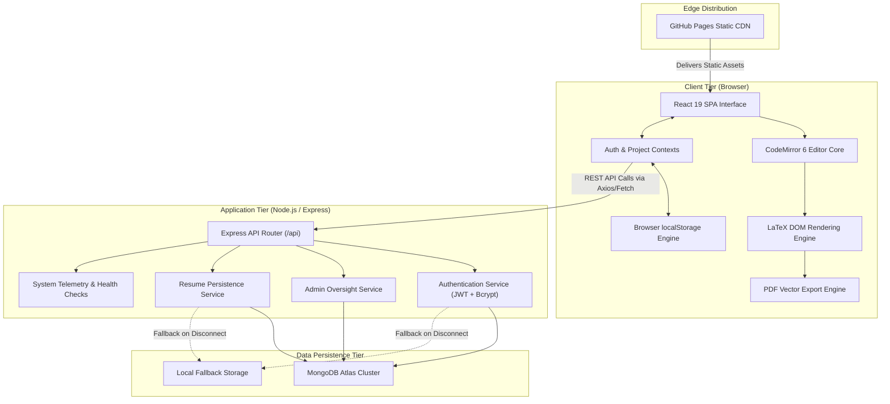
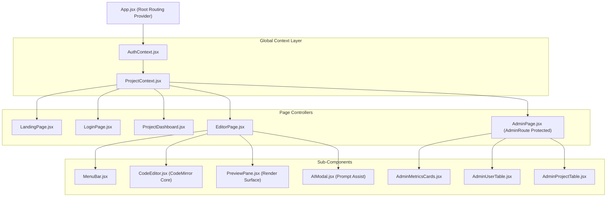
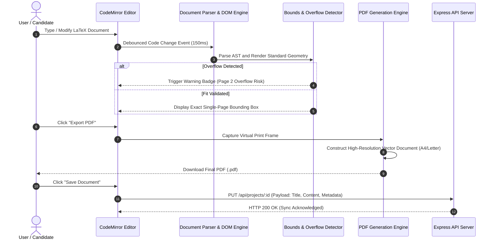
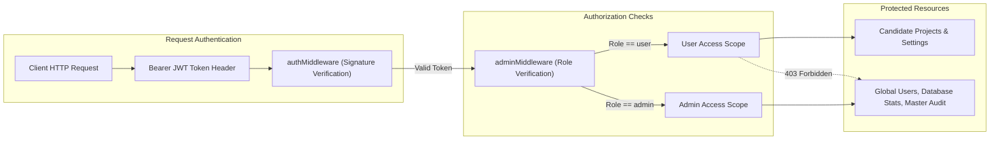

# SR Builder

An ATS-optimized, LaTeX-grade single-page resume engineering platform and web IDE.

[](https://shubhnamdeo.github.io/sr-builder/)
[](#license)
[](https://nodejs.org/)
[](https://react.dev/)

[Launch Live Application](https://shubhnamdeo.github.io/sr-builder/)

---

## Table of Contents

- [Overview](#overview)
- [System Architecture (High-Level Design)](#system-architecture-high-level-design)
- [Component Architecture (Low-Level Design)](#component-architecture-low-level-design)
- [Data Flow and Compilation Pipeline](#data-flow-and-compilation-pipeline)
- [Security and Role-Based Access Control](#security-and-role-based-access-control)
- [Database Schema Design](#database-schema-design)
- [Project Directory Structure](#project-directory-structure)
- [Local Installation and Setup](#local-installation-and-setup)
- [Build and Deployment Guide](#build-and-deployment-guide)
- [License](#license)

---

## Overview

SR Builder is an Overleaf-inspired, deterministic single-page resume authoring platform built for technical candidates and engineering recruiters. The platform combines the semantic precision of LaTeX typesetting with real-time browser previewing, strict one-page enforcement, ATS (Applicant Tracking System) parsing compatibility, and administrative telemetry.

### Core Capabilities

- **Real-Time Synchronous Editor**: CodeMirror 6 dual-pane editor with syntax highlighting, line numbers, and live DOM rendering.
- **Strict Single-Page Bounds**: Optical height measurement prevents unintended page spills and formatting rejections by recruiters.
- **Vector PDF Export Engine**: Client-side document rasterization and pagination using jsPDF and html2canvas.
- **Administrative Portal**: Dedicated dashboard for monitoring platform analytics, candidate accounts, and LaTeX code repositories.
- **Resilient Fallback Storage**: Dual-mode data persistence supporting cloud MongoDB databases and offline localStorage caching.

---

## System Architecture (High-Level Design)

The system is designed with a decoupled client-server architecture. The frontend functions as a self-contained progressive client application capable of autonomous compilation, while the optional backend provides collaborative storage and administrative governance.



---

## Component Architecture (Low-Level Design)

The client application follows a reactive, component-driven hierarchy governed by React Context providers for global authentication and state synchronicity.



### Context and State Responsibilities

1. **AuthContext**:
   - Manages user sessions, JWT lifecycles, and persistent credentials.
   - Evaluates administrative authority and secures role-sensitive routes.
   - Handles hybrid auth logic (MongoDB cloud session with zero-latency local fallback).
2. **ProjectContext**:
   - Manages active resume buffers, document revisions, and metadata (title, owner, timestamps).
   - Manages local project caches and syncs asynchronous updates with the REST server.

---

## Data Flow and Compilation Pipeline

The resume compilation flow translates raw LaTeX markup into ATS-compliant document representations within the browser environment.



---

## Security and Role-Based Access Control

Access control enforces strict separation between candidate accounts and administrative operations.



### Security Invariants

- **Sole Administrator**: Administrative privilege is strictly restricted to designated administrative identity (`Shubh Namdeo`).
- **No Unauthorized Privilege Escalation**: Standard registrations cannot request or receive administrator roles. The API blocks and rejects role elevation requests for non-designated accounts.
- **Session Protection**: All administrative endpoints under `/api/admin/*` require cryptographically signed JSON Web Tokens (JWT) verified through middleware.

---

## Database Schema Design

The application utilizes MongoDB schemas defined via Mongoose models:

### 1. User Entity (`users` collection)

| Field | Type | Attributes | Description |
| :--- | :--- | :--- | :--- |
| `_id` | ObjectId | Primary Key | Unique user identifier |
| `name` | String | Required, Trim | Full name of the candidate |
| `email` | String | Required, Unique, Lowercase | Unique user ID or email handle |
| `passwordHash`| String | Optional (Nullable on OAuth) | Salted bcrypt credential hash |
| `role` | String | Enum: `['user', 'admin']` | Security role level (Default: `user`) |
| `plan` | String | Enum: `['free', 'pro']` | Subscription tier |
| `createdAt` | Date | Default: `Date.now` | Account registration timestamp |

### 2. Project Entity (`projects` collection)

| Field | Type | Attributes | Description |
| :--- | :--- | :--- | :--- |
| `_id` | ObjectId | Primary Key | Unique document identifier |
| `userId` | ObjectId | Ref: `User`, Required | Foreign key reference to document author |
| `title` | String | Required, Default: `Untitled`| Document display title |
| `owner` | String | Default: `You` | Ownership badge identifier |
| `content` | String | Required | Full raw LaTeX source markup |
| `archived` | Boolean| Default: `false` | Soft-archival flag |
| `trashed` | Boolean| Default: `false` | Recycle bin lifecycle state |
| `lastModified`| Date | Default: `Date.now` | Last edit epoch timestamp |
| `createdAt` | Date | Default: `Date.now` | Initial document creation timestamp |

---

## Project Directory Structure

```text
resume-builder/
├── .github/
│   └── workflows/
│       └── deploy.yml              # Automated GitHub Pages CI/CD pipeline
├── public/                         # Static application assets
├── server/                         # Express API backend
│   ├── config/                     # Database connection setup
│   ├── middleware/
│   │   ├── admin.js                # Administrator verification middleware
│   │   └── auth.js                 # JWT authentication middleware
│   ├── models/
│   │   ├── Project.js              # Project document schema
│   │   └── User.js                 # User identity schema
│   ├── routes/
│   │   ├── admin.js                # Administrative control endpoints
│   │   ├── auth.js                 # Authentication and session endpoints
│   │   └── projects.js             # Resume CRUD endpoints
│   ├── .env                        # Server environment configuration
│   └── server.js                   # Application server entry point
├── src/                            # Frontend React application
│   ├── assets/                     # Graphic resources and icons
│   ├── components/                 # Reusable UI component library
│   │   ├── CodeEditor/             # CodeMirror editor wrappers
│   │   ├── MenuBar/                # Top navigation and export toolbar
│   │   └── Preview/                # Document render frame
│   ├── contexts/
│   │   ├── AuthContext.jsx         # Identity and permission state
│   │   └── ProjectContext.jsx      # Resume state management
│   ├── pages/
│   │   ├── Admin/                  # Administrator monitoring portal
│   │   ├── Editor/                 # Dual-pane authoring workspace
│   │   ├── Landing/                # Platform introduction and feature tour
│   │   ├── Login/                  # Authentication interface
│   │   └── ProjectDashboard/       # User project portfolio
│   ├── services/
│   │   └── api.js                  # Centralized REST API client
│   ├── App.jsx                     # Top-level client routing table
│   ├── index.css                   # Obsidian black base styles
│   └── main.jsx                    # Vite runtime bootstrap
├── package.json                    # Project metadata and dependencies
└── vite.config.js                  # Vite bundler configuration
```

---

## Local Installation and Setup

### Prerequisites

- Node.js (version 20.0.0 or higher)
- npm (version 10.0.0 or higher)
- MongoDB instance (Local or MongoDB Atlas cluster URI)

### 1. Repository Setup

```bash
git clone https://github.com/Shubhnamdeo/sr-builder.git
cd sr-builder
```

### 2. Frontend Installation and Launch

```bash
npm install
npm run dev
```

The frontend client will be available at `http://localhost:5173`.

### 3. Backend Service Installation and Launch

```bash
cd server
npm install
node server.js
```

The backend API server will start on port `5000` (`http://localhost:5000/api/health`).

---

## Build and Deployment Guide

### Production Bundle Build

To create an optimized production build of the client application:

```bash
npm run build
```

Compiled static artifacts will be generated in the `dist/` directory.

### Continuous Deployment (GitHub Pages)

The repository includes an automated GitHub Actions deployment workflow at `.github/workflows/deploy.yml`. When code is pushed to the `main` branch, the workflow:

1. Checks out the repository.
2. Installs dependencies via npm.
3. Compiles the Vite frontend bundle into `./dist`.
4. Deploys the bundle directly to GitHub Pages.

Live URL: `https://shubhnamdeo.github.io/sr-builder/`

---

## License

This project is licensed under the MIT License. See the repository for complete licensing terms.
